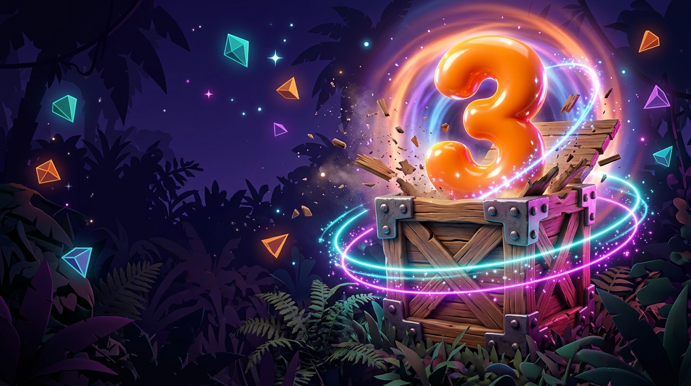
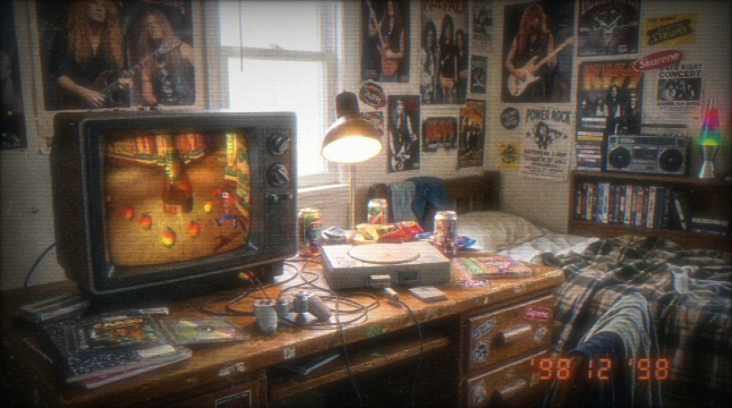
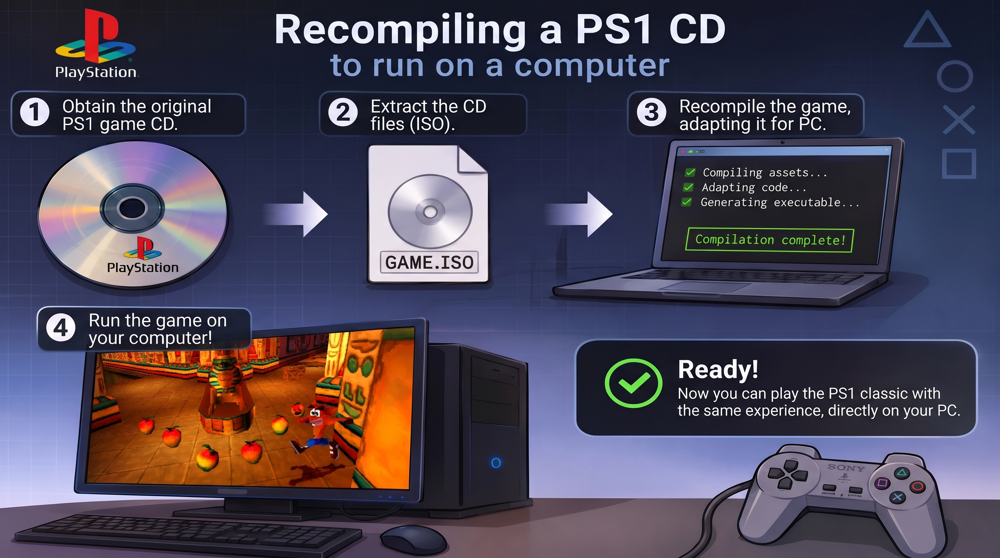

# Crash Bandicoot 3: Warped Recompiled

Unofficial fan project.

Crash Bandicoot 3: Warped (PS1, 1998), running natively on PC. In widescreen, at up to 240 FPS, at up to 6x resolution.

This isn't an emulator. The original PS1 code is statically recompiled into a native program **on your own machine**, then given upgrades the PS1 never had: a real 16:9 view, high frame rates, high resolutions, mods and cheats.

## What you get

- **Native widescreen (16:9).** The game draws more of the world on both sides instead of stretching the image.
- **High frame rate.** Up to 240 FPS, capped to your monitor.
- **High resolution.** Internal resolution up to 6x, with optional integer scaling.
- **Cleaner image.** PGXP (no wobbly polygons, correct textures), anti-aliasing, dedither and dejitter. Each one can be turned off.
- **Quick save and quick load.** F2 saves, F3 loads.
- **Mods.** Cosmetic swaps (Fake Crash, Coco) and paint jobs (Gold, Arctic, Shadow, Toxic, Sakura, N. Sane). Crash keeps all his moves.
- **Cheats.** All crystals, gems and relics, all levels, infinite lives, all powers, god mode, infinite jumps.
- **Controllers and keyboard.** PS4 and other gamepads work out of the box.
- **Launcher in 7 languages.** English, Español, Français, Deutsch, Italiano, Русский, Português.
- **Plays from a .cue + .bin or .chd dump.** No extraction needed.

Graphics start on the **N. Sane** preset (240 FPS, 16:9, AA, 6x). On a weaker GPU, lower it in Settings.

Every extra is optional, so you can play it exactly like the original.

## Quick start

You need your own dump of **Crash Bandicoot 3: Warped (USA), serial SCUS-94244**, as a `.cue` + `.bin` or a `.chd`. The game is not included; read the fine print.

1. Download `Crash3-Warped-Recompiled-win-x64.zip` from **Releases** and unzip it somewhere you can write to (not Program Files).
2. Run `Crash3Launcher.exe`.
3. Click **Select disc** and choose your `.cue` or `.chd` (asked only once).
4. Click **Start Game**.

The first launch builds the game from your disc on your PC, which takes a moment. Later launches start straight away.

### Controls (keyboard)

| Key | Action |
|---|---|
| Arrows | D-pad |
| Z / X / A / S | Cross / Circle / Square / Triangle |
| Enter | Start |
| F11 | Fullscreen |
| F1 | Menu bar |
| F2 / F3 | Quick save / quick load |

## System requirements

- Windows 10 or 11, 64-bit. No .NET install needed.
- Microsoft Edge WebView2 Runtime (already on most PCs; the launcher links to it if missing).
- A GPU with Vulkan or OpenGL support.

Settings, memory cards and logs are saved in the game folder.

## How it works

1. You point the launcher at your disc.
2. The [RecompOne](https://github.com/BlackLabelHQ/RecompOne) recompiler translates the game's MIPS code into C# and compiles it on your PC. Nothing is uploaded anywhere.
3. A runtime provides enough of a PS1 (BIOS, GPU, sound, CD) for that code to run, with a modern renderer.

There's no telemetry.

## Found a bug?

Open an issue with the level name and a short description of what happened.

Please don't ask where to download the game, and never attach disc images or generated game code.

## Known issues:

- Some models might seem "a bit off", this is normal due to a combination of factors such as FPS and Resolution (I'll definitely fix it)
- Coco & Fake Crash are not fully functionals, since they do NOT exist in the game files to be played, it is just an experiment (maybe, I'll fix it)
- Widescreen & Rendering: Since the game was made to run in a PS1, the widescreen rendering is known to be plagued by "black polygons", I made a fix to it,
- however you'll still see some weird renderings because the game was engineered to run in this specifically way. I'll try my best to fix it to be seemless in future updates.

## Thanks

- **RecompOne** by flaffy: the static PS1 recompiler and runtime this is built on (MIT).
- **Silk.NET**, **ImGui.NET**, **SDL2**, **OpenAL Soft**, **NVorbis**, **MonoMod**, **StbImageSharp**, **NativeFileDialog**: the libraries that make the runtime work.
- The static recompilation community (N64Recomp, XenonRecomp and friends), for showing it could be done.
- Naughty Dog, for making the game.

## The fine print

- **Unofficial fan project.** Not affiliated with or endorsed by Sony Interactive Entertainment, Activision, Naughty Dog, or any rights holder. Crash Bandicoot and related names and marks belong to their respective owners.
- **The game is not included.** This repo and its releases have no ISOs, no disc images, no game assets and no recompiled game code. You need a dump of a disc you own. If you find this project bundled with a game file, it didn't come from here.
- **License:** the original code in this repo is MIT. RecompOne and the third-party libraries keep their own licenses and notices. The license covers this software only and grants no rights to Crash Bandicoot itself.
